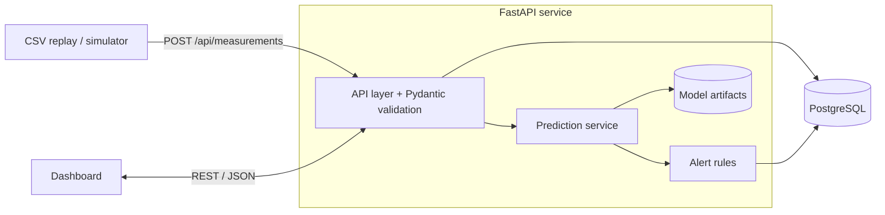
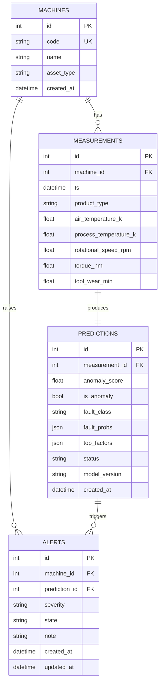

# 04 - Architecture Sketch

A **modular monolith**: one FastAPI service, one PostgreSQL database, one frontend. No microservices.

## Components

## Data flow
Measurement input -> API validation -> PostgreSQL -> ML inference -> prediction/alert storage -> dashboard.

## Design decisions
- Models and preprocessing are loaded **once at startup**, with the same feature order as in training.
- ML code in `ml/` produces artifacts in `models/`; the backend only loads and serves them.
- Alembic migrations for all schema changes.
- Config via environment variables; structured logging.
- Docker Compose is optional (cut-list item 4).

## Database model (initial)

## API surface
| Method | Endpoint | Purpose |
|---|---|---|
| POST | /api/machines | Register a machine |
| GET | /api/machines | List machines + latest status |
| POST | /api/measurements | Submit measurement, trigger inference |
| GET | /api/machines/{id}/history | Measurement + prediction history |
| GET | /api/alerts | Active and historical alerts |
| PATCH | /api/alerts/{id} | Acknowledge / resolve |
| GET | /health | Health check (Day 6) |

## Frontend pages
Overview (counts, alerts, recent predictions) / Machine detail (trends, predictions, explanation) / Alerts and history (workflow).
